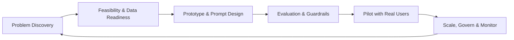

<h1 align="center">Anil Kumar Meher</h1>
<h3 align="center">Technical Architect · SAP Platform Lead · AI Product Manager</h3>

<i>10+ years turning complex enterprise platforms into products people actually use, now applying that to AI.</i>

  
  
  

---

## 👨‍💼 About Me

I'm a **Technical Architect & Platform Lead** with **10+ years** across cloud infrastructure and SAP enterprise landscapes. I'm now moving into **Technical Product Management (2027)**, specializing in **AI products**. I'm currently upskilling in **Applied AI at IIT Roorkee**.

My edge is sitting between the three worlds that AI product work needs:

| 🏗️ Architecture | 📦 Product | 🤖 AI |
|---|---|---|
| I know how enterprise systems really work and where they break | I know how to turn messy needs into roadmaps, specs and outcomes | I know how to take LLMs from demo to governed, measurable production features |

---

## 🎯 What I Do

- 🧭 **Define product strategy** for enterprise and AI platforms: vision, roadmap, prioritization, success metrics
- 🏛️ **Architect SAP landscapes** on BTP with Clean Core principles, extensibility and integration
- 🤖 **Design AI-powered products**: agents, RAG, copilots, prompt orchestration and evaluation
- 🤝 **Align stakeholders**: business, engineering, security, finance and leadership
- 📈 **Drive adoption and value**: business cases, KPIs, change management and go-to-market

---

## 🧰 Skills & Toolkit

### 🔷 SAP Expertise

**Focus areas:** Clean Core strategy · S/4HANA migration & transformation · side-by-side extensibility · API-first integration · event-driven architecture · Basis & landscape management · security & authorizations · performance optimization · multi-cloud resilience · SAP Business AI (Joule, AI Core, Generative AI Hub)

### 🤖 AI & Product Specialization

**Focus areas:** use-case discovery & AI feasibility · build vs. buy vs. fine-tune · RAG and agent architecture · prompt design (Zero/Few-Shot, CoT, ReAct) · evaluation frameworks & quality metrics · hallucination and risk mitigation · cost, latency and token economics · human-in-the-loop design · AI governance & compliance · data readiness · AI product analytics

### 📦 Product Management

**Focus areas:** product vision & strategy · roadmapping · PRDs & user stories · discovery & customer interviews · OKRs & North Star metrics · prioritization (RICE, WSJF, Kano, MoSCoW) · business cases & ROI · go-to-market · stakeholder management · agile / SAFe · backlog & release management · A/B testing · pricing & packaging

### ☁️ Cloud, Infrastructure & Engineering

**Focus areas:** multi-cloud architecture · hyperscaler hosting for SAP · high availability & disaster recovery · CI/CD · infrastructure as code · FinOps / cost optimization · observability · security & compliance

---

## 🔄 How I Approach AI Products

1. **Start with the problem, not the model.** Is AI even the right tool?
2. **Measure quality before shipping.** Define evals, test sets and failure modes early.
3. **Design for trust.** Guardrails, citations, human review and clear fallbacks.
4. **Respect the economics.** Track cost per task, latency and adoption, not just accuracy.
5. **Govern continuously.** Monitor drift, safety and compliance after launch.

---

## 📂 Featured Repositories

| Repo | Focus | What you'll find |
|---|---|---|
| 🧭 [tpm-architecture-and-strategy](https://github.com/ANILKMEHER/tpm-architecture-and-strategy) | Strategy | SAP BTP architecture, enterprise AI roadmaps, product frameworks |
| 🤖 [personal-agent-hub](https://github.com/ANILKMEHER/personal-agent-hub) | AI Agents | Task-specific agents with deterministic prompting, MCP connectors, memory layers |
| 🏛️ [sap-enterprise-architecture](https://github.com/ANILKMEHER/sap-enterprise-architecture) | SAP | Clean Core, optimization blueprints, Python automation, multi-cloud resilience |
| ✍️ [prompt-methodology-and-engineering](https://github.com/ANILKMEHER/prompt-methodology-and-engineering) | Prompting | Zero/Few-Shot, CoT, ReAct and RAG templates |
| 📐 [pm-decision-frameworks](https://github.com/ANILKMEHER/pm-decision-frameworks) | Product | 10+ strategic and analytical PM frameworks |

---

## 🌱 Currently

- 🔭 Building **personal-agent-hub**, a modular suite of personal AI agents
- 📚 Studying **Applied AI at IIT Roorkee**
- 🧪 Exploring **agentic workflows, MCP and enterprise AI governance**
- 🎯 Preparing for a **Technical Product Management** role in **2027**

## 💬 Ask Me About

`SAP BTP` · `Clean Core` · `S/4HANA transformation` · `AI product strategy` · `RAG & agents` · `Prompt engineering` · `AI evals & governance` · `Product roadmapping` · `Enterprise architecture`

---

## 📊 GitHub Stats

  
  

---

## 🤝 Let's Connect

I'm open to conversations about **AI product management, SAP and enterprise AI, and TPM roles**.

  

<i>"Great products sit where architecture, strategy and users meet."</i>

